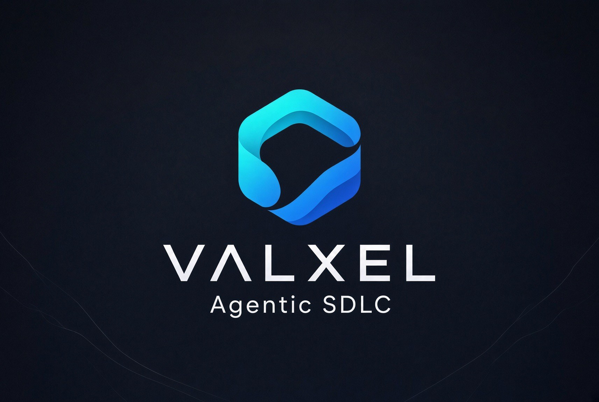
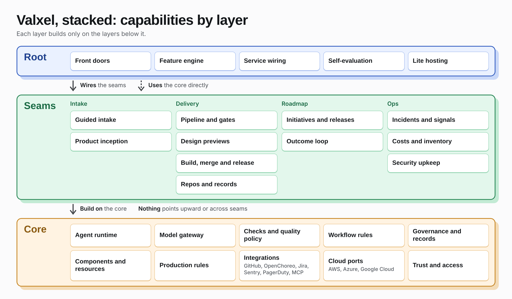
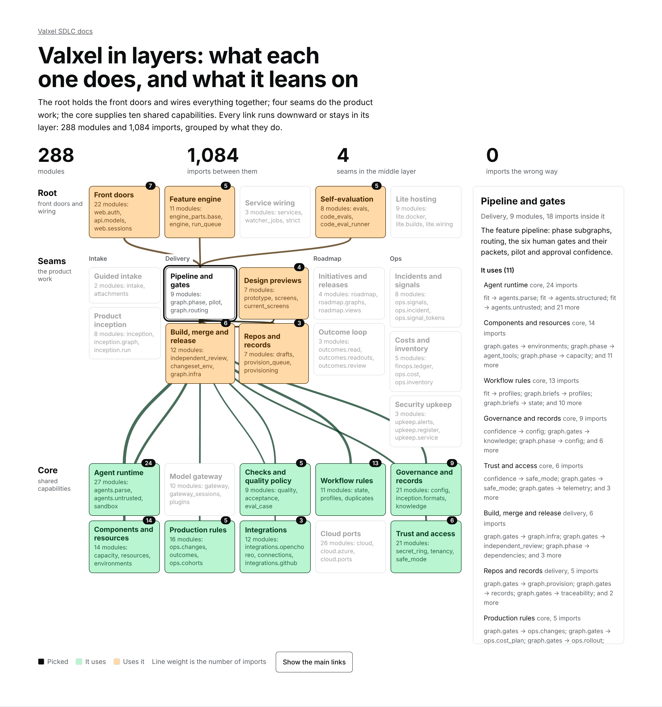

<p align="center"></p>

# Valxel Agentic SDLC

Valxel Agentic SDLC is an agentic software development lifecycle built on LangGraph. Agents built from
the Product, Design and Engineering plugin skills take a feature from idea to production. Humans
decide at six gates, and an escalation path takes over a phase when agents are stuck.

This release wires the **whole pipeline end to end with stub agents**: all eight phases, all six
gates, evaluator loops, escalations, the model gateway, the usage ledger and product
constitutions. It runs offline and deterministically. Each stub sits behind an interface you
replace with the real integration (see [Replacing the stubs](docs/operators.md#replacing-the-stubs)).

**[Architecture](docs/architecture.md)**: how the parts fit together, how a feature and an
incident move through the tool, and the design rules.

<p align="center"><a href="docs/architecture.md#how-its-stacked"></a></p>

How it's stacked: the root wires the four seams, the seams do the product work, and the core
supplies what they share. [The same layers in detail](docs/architecture/capability-layers-detailed.png).

**[Module map](https://valxel-platform.github.io/agentic-sdlc/module-map.html)**: every module of the tool, the capability and layer it belongs to, and
what it imports and what imports it. Pick a capability to see the capabilities it uses and the ones that use it,
down to the module pairs; pick a module for its own links. Generated from the code by
`scripts/module_map.py`.

<p align="center"><a href="https://valxel-platform.github.io/agentic-sdlc/module-map.html"></a></p>

```
discovery ─G1─ spec ─G2─┬─ design ───────G3─┬─ join ─ provision new repos ─ plan ─ build ─ CI ─[G5 if high risk]─ merge train
                        └─ architecture ─G4─┘    ─ build, deploy dev and staging ─ release ─G6─ production ─ operate
any phase ── 3 failed evaluator loops or budget spent ──> escalation (human takeover)
```


Why it's built this way: [architecture decision records](docs/adr/README.md). Its parts (intake, the
roadmap, delivery, operations) are seams in one codebase, kept apart by `config/seams.yaml` and
`tests/test_seams.py` (ADR 0005).
## Quick start

### The whole thing on a laptop (live models, real GitHub, products on local Docker)

```bash
printf '%s\n%s\n' "$ANTHROPIC_KEY" "$GITHUB_TOKEN" | valxel dev init --anthropic-key-stdin --github-token-stdin
valxel dev doctor && valxel dev up
```

The model key stays in the LLM gateway; products are built and deployed on this machine's Docker
(ADR 0007, [the laptop guide](src/valxel_sdlc/laptop/bundle/README.md)). The compose file below is the
offline demo: canned agents, nothing leaves the machine.

### Docker compose (Postgres-backed, durable threads)

```bash
docker compose up --build
open http://localhost:8080             # web interface
open http://localhost:8080/docs        # interactive API
```

Compose starts with development sign-in (`VALXEL_AUTH=dev`): type any GitHub login and tick the
teams to act as, for example `acme-clinic/product-owners`. Use GitHub sign-in for anything shared
(see [Web interface](docs/operators.md#web-interface)).

### Without Docker

```bash
pip install -e ".[dev]"
pytest -n auto                           # on every CPU; set VALXEL_TEST_DATABASE_URL for the Postgres tests
                                         # (each worker makes its own database beside that one)
valxel demo --product CLN --fault spec=1 --revise

(cd web && npm ci && npm run build)      # build the web interface into web/dist
VALXEL_AUTH=dev VALXEL_SESSION_SECRET=$(openssl rand -hex 32) \
  uvicorn --factory valxel_sdlc.api.app:create_app --port 8080 --reload
```

For frontend work, run the API as above and `cd web && npm run dev`. Vite serves the app on
port 5173 and proxies `/api` to port 8080. To fill a fresh stub-mode server with features at different stages, run
`python web/scripts/seed.py` (it signs in as `demo` through development sign-in).

`valxel demo` runs one feature through every phase, auto-approving gates. `--fault spec=1` makes
the first PRD defective, so the evaluator loop fixes it, and `--revise` sends the design back once
at G3.

## Where to read next

| You are | Read |
|---|---|
| Running the tool: installing it, sign-in, workspaces, security, models | [docs/operators.md](docs/operators.md) |
| A product team delivering with it: governance, inception, roadmap, delivery, operations, cost | [docs/product-teams.md](docs/product-teams.md) |
| Changing the tool itself: agents, evals, the pilot, how the code is laid out | [docs/contributors.md](docs/contributors.md) |
| Anyone: how the parts fit together | [docs/architecture.md](docs/architecture.md), [ADRs](docs/adr/README.md) |
| On call | [docs/runbooks](docs/runbooks) |

## License

Valxel SDLC is source-available under the [Business Source License 1.1](LICENSE). Each release
becomes open source under the Apache License 2.0 three years after it is published. See
[NOTICE](NOTICE).

**Free to use in production** for individuals; for organizations with fewer than 250 people
(employees and contractors, affiliates included) and under US$10M annual revenue; and for
schools and nonprofits. Anyone may read, change and test the code, at any size. The one use the
license never grants for free is offering Valxel to others as a hosted or managed service.
Building your own software with it, including software for clients, is not that.

**Larger organizations** need a commercial license for production use. It gives the same
features at a published yearly price; there is no separate enterprise edition. Pricing and how to
buy are coming soon; until then, open an issue to ask.

Versions up to and including 0.1.0 (commit `dd8b60f` and earlier) were published under the
Apache License 2.0 and remain under it.

The method, templates and platform files in the other `valxel-platform` repositories are MIT
licensed. Contributions are accepted under each repository's license. No license gives rights to
the Valxel name or logo.
