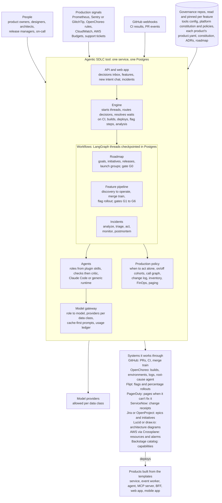

# Architecture

How the tool fits together, at a high level. The [README](../README.md) has the detail for each
part; [How the design maps to code](../README.md#how-the-design-maps-to-code) and
[Layout](../README.md#layout) list the modules.

The tool is one Python service with one Postgres database. Agents do the work, people decide at
gates, and each product's own governance repo sets the rules the tool must follow. Everything
outside the tool box below belongs to the products or to third parties, and the tool reaches each
through an interface with an offline stub, so the whole pipeline runs deterministically in tests.
Running products close the loop: their alerts, errors, logs and flag on/off counts come back to the
tool as production signals.

## How work moves through it

**Idea to production**: one feature thread, across every repo it touches.

1. The intake agent drafts the intent with the person and checks what the product already has.
2. Discovery, then spec, approved at G1 and G2.
3. Design and architecture run in parallel, approved at G3 and G4, then join. The architect's
   diagram is published to Lucid or draw.io for G4 reviewers.
4. New repos are provisioned from templates. The planner splits the work: one coder agent per
   task, one reviewer per pull request.
5. CI must go green. High-risk and regulated changes need G5. The merge train merges libraries,
   then providers, then consumers.
6. OpenChoreo builds the merge commits and deploys to dev, then staging.
7. Release managers approve production and a rollout plan at G6.
8. The flag steps through 5, 25, 50 and 100%. It holds on incidents in or around the changed
   components and stops if users with it on fail more than users with it off.

**Signal to resolution**: the tool does the heavy lifting; on-call is paged only when it can't.

1. A signal joins an open incident or opens one. A SEV1 sends on-call a low-urgency heads-up.
2. OpenChoreo's root-cause agent investigates, on a provider allowed for the data class, while the
   tool correlates recent changes.
3. Triage proposes actions. Suspects are recent releases and features still rolling out nearby.
4. When the policy allows and the analysis agrees, the tool turns the flag off or rolls back, and
   records the change.
5. It watches for recovery. If it can't act, its action fails, or the failure continues, it pages
   on-call urgently.
6. The fix goes back through the pipeline as a hotfix, and the postmortem is drafted into the
   product's governance repo.

**What every step leaves behind**, for audit and for looking back:

- Each decision: who approved, at which gate, with how many active minutes.
- Each production change: who or what made it and why, with a ServiceNow receipt.
- Each model call: role, model, tokens, cache hits and cost, in the usage ledger.
- Each feature's cost in production, from FinOps, beside its build cost.
- The resource inventory: what runs in production against the lower environments.
- Traces of every thread, and postmortems and ADRs in Git.

## Design rules

- **Agents work, people decide.** Gates G0 to G6 wait for an approver named in the product's own
  governance repo. Three failed evaluator loops, or a spent budget, hand the phase to a person.
- **Products own their rules.** The tool keeps no product settings. It reads each product's
  governance repo and pins it by commit for the life of a feature. Products can tighten the
  platform's rules, never loosen them.
- **Data class picks the model.** The gateway routes PHI and payments work only to providers
  covered for it. The same rule decides which provider OpenChoreo's root-cause agent may use.
- **Production stays human, with two exceptions.** Promotion to production is a person's decision
  at G6. The tool may act alone only to turn off a recent feature's flag or roll back a recent
  release, when the policy allows it and the analysis agrees.
- **Threads survive restarts.** LangGraph checkpoints every step in Postgres, so waits on people,
  CI and deploys resume after a restart.
- **Every integration is an interface.** Stub mode runs offline and deterministically; live mode
  swaps in Claude Code, the Claude API and the real systems one interface at a time.

## Keeping this current

Update this page in the same pull request as any change that adds, removes or moves a part of the
tool shown here.
