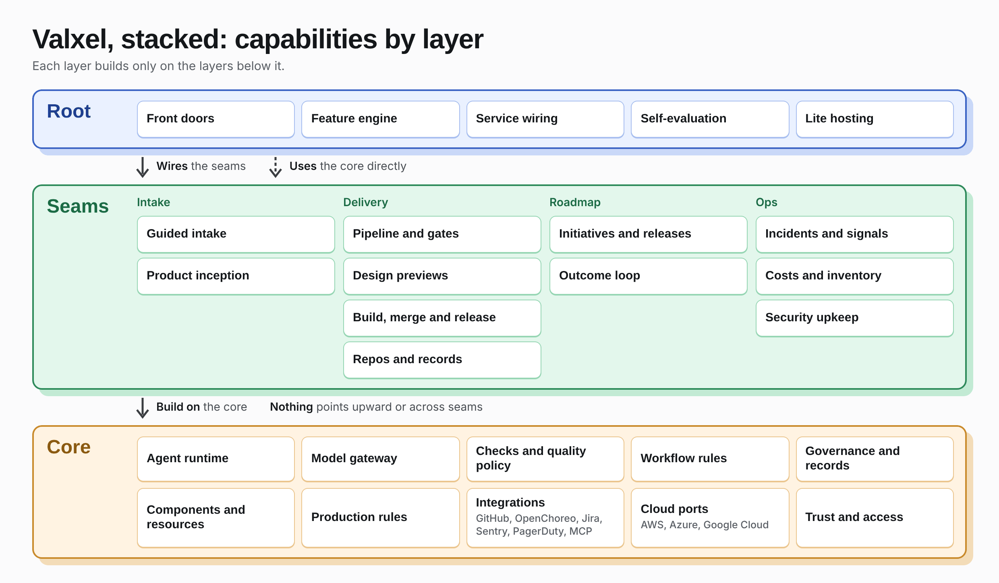

# Architecture diagrams

How the tool is stacked, and where each part runs, on a developer's laptop and in production. The
[architecture overview](../architecture.md) shows what the parts do; these show where they live and
what may talk to what.

| File | What it is |
| --- | --- |
| [deployment-laptop.png](deployment-laptop.png) | The laptop tier (`valxel dev up`, [ADR 0007](../adr/0007-deployment-tiers.md)) |
| [deployment-cluster.png](deployment-cluster.png) | The cluster tier: the Helm chart in [`deploy/helm/valxel`](../../deploy/helm/valxel/README.md) in a customer's cloud account |
| [deployment.drawio](deployment.drawio) | Both, editable: open it in [draw.io](https://app.diagrams.net) (File → Open), one page per tier |
| [capability-layers.png](capability-layers.png) | The capability layers: root, seams and core, names only |
| [capability-layers-detailed.png](capability-layers-detailed.png) | The same, with what each capability does |
| [capability-layers.html](capability-layers.html), [capability-layers-detailed.html](capability-layers-detailed.html) | Their sources: edit, then run [render_layers.py](render_layers.py) |

Colors: purple is the tool, amber a security boundary, teal data, green the products, gray outside
systems.

## Laptop tier

- Everything runs in one Compose project on the developer's machine; the API listens on
  `127.0.0.1:8080` only.
- Agent sessions run one container each on `valxel-sessions`, an internal network with no route out.
  They reach the LLM gateway (which alone holds the model key) and the egress proxy, nothing else.
- The egress proxy tunnels to the package registries and is the git broker: sessions push and fetch
  with a pass, the proxy puts the GitHub token on, and a session can push only to its own
  repository ([`git_broker.py`](../../src/valxel_sdlc/git_broker.py)).
- Products run as their own Compose projects on the host's Docker; OpenChoreo in k3d is optional.

## Cluster tier

- The `valxel` namespace runs strict mode: API and workers (two replicas each), the provisioning
  worker (the only signer for the Provisioning App), the LLM gateway, the egress proxy, audit Kafka
  and the audit sink.
- Sessions are Agent Sandbox pods under gVisor in their own namespace: no service-account token, no
  GitHub token. Network policy (Cilium, or portable `NetworkPolicy`) lets them reach the egress
  proxy and the gateway only; the proxy alone reaches the egress list
  ([`config/egress.yaml`](../../config/egress.yaml)).
- Istio ambient gives every pod mTLS; authorization policies admit only the session identity to the
  proxy and the gateway.
- Managed services: Postgres (three databases), S3 Object Lock for the checkpoint and audit
  archives, KMS for the GitHub App keys (sign-only), Cognito and External Secrets.

Not every connection is drawn: the API and workers also use Postgres and the artifacts volume, and
the provisioning worker signs through KMS.

## Keeping these current

Change `deployment.drawio` and re-export both PNGs in the same pull request as any change to the
Compose bundles, the Helm chart or the network policy that adds, removes or moves a part or a
connection shown here.

## Capability layers

- **Root:** the front doors (API, web console, A2A and MCP), the feature engine that starts and
  resumes every thread, service wiring, the tool's evals of its own agents, and lite hosting.
- **Seams:** intake, delivery, the roadmap and ops. Each uses only itself and the core, never another
  seam.
- **Core:** shared by every layer. It imports no seam.
- Colors: blue is the root, green the seams, amber the core.
- The groupings follow the modules' own descriptions and `config/seams.yaml`; the
  [detailed version](capability-layers-detailed.png) lists what each capability does.
